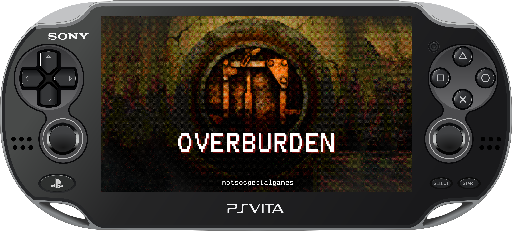

  An experimental, unofficial port of <a href="https://whatd0g.itch.io/tenebrarium"><strong>Tenebrarium</strong></a> for PlayStation Vita.

  <em>Powered by a customized <a href="https://github.com/WolffsRoom/godot4-vita">Godot 4 Vita</a> runtime, with native GXM 2D rendering.</em>

> [!IMPORTANT]
> **Work in progress!**
> The port boots and runs on real PS Vita hardware, but there is **no public build yet**. Get the original game on [itch.io](https://whatd0g.itch.io/tenebrarium). This repository does not distribute the game's files.

## Project status

  
  
   
  
  

 

The first test build ran on a physical PS Vita on its first boot. Work now focuses on frame rate, load time, controls and the remaining rendering differences.

| Component | Current state |
| :--- | :--- |
| Boot / LiveArea | Animated 960 × 544 startup, custom LiveArea |
| Gameplay | Running on physical hardware, testing in progress |
| Controls | Analog stick and touch drive the pointer, D-pad moves between buttons, L / R zoom |
| Rendering | Native GXM 2D backend: nine-patch panels, polygons, magnifier viewport; shader effects approximated |
| Audio | Music and sound effects working |
| Performance | Below 60 FPS on the first build; draw batching under test |
| Public VPK / Release | Not available yet |

_If you enjoy my work, consider supporting the development!_

 <strong>Support this and other projects</strong></a>

## About the port

*Tenebrarium* is a pixel-art terrarium game by **whatd0g** in which you look after a colony of strange creatures living in the dark. This project runs the original game's Godot content through a PlayStation Vita-specific runtime rather than recreating it in a different engine.

The game was made for mouse and keyboard at 640 × 360. On the Vita it is shown at 1.5× (960 × 540). The front touch screen and the left analog stick move the pointer, the D-pad jumps between buttons, Cross and Circle act as the left and right mouse buttons, L / R zoom and Start opens the menu.

This is an **unofficial fan project**, not affiliated with or endorsed by whatd0g, Sony, or the Godot Engine project.

## Controls

| Vita | Action |
| :--- | :--- |
| Left analog stick / touch screen | Move the pointer (touch also clicks) |
| D-pad | Move between buttons, one item at a time |
| Cross | Left click |
| Circle | Right click (cancel the current tool or item) |
| R / L | Zoom in / out (also switches magnifier and identifier) |
| Right analog stick | Scroll lists |
| Start | Options menu |

## Current development priorities

- Measure and raise the frame rate on hardware (batched GXM drawing, fewer clip changes).
- Shorten the initial load (single game pack, pre-tokenized scripts, music loaded in parallel).
- Confirm the magnifier, identifier and title screen on hardware.
- Prepare an installation method that does not redistribute the game's files.

See [Development status](docs/PORT_STATUS.md).

## Technical background

This port is built around [Godot 4 Vita](https://github.com/WolffsRoom/godot4-vita), [VitaSDK](https://vitasdk.org) and a native [GXM](https://www.psdevwiki.com/vita/SceGxm) 2D rendering path. The game targets Godot 4.6; the Vita runtime is a Godot 4.8 development build.

The Vita renderer does not run custom shaders. Effects that read the screen (CRT filter, palette swaps) are replaced by tinting, and the creature shadow shader is replaced by pre-baked silhouettes.

## Credits

- [whatd0g - Tenebrarium](https://whatd0g.itch.io/tenebrarium): original game, characters, artwork, sound and design.
- [Godot Engine](https://godotengine.org): original engine.
- [WolffsRoom / Godot 4 Vita](https://github.com/WolffsRoom/godot4-vita): experimental Vita runtime and rendering backend.
- [VitaSDK](https://vitasdk.org) and the wider PS Vita homebrew development community.

---

<em>This repository is documentation-only during development.
The original game and all of its associated intellectual property remain the property of their respective rights holders.</em>

